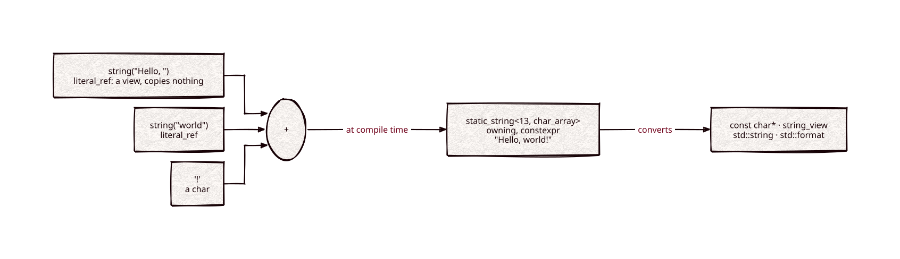

# static-string

Part of [Kronuz C++ Libraries](https://github.com/Kronuz/cpp-libraries), a collection of small, reusable C++ libraries.

[](https://github.com/Kronuz/static-string/actions/workflows/ci.yml)
[](LICENSE)


Compile-time strings for C++20: concatenate literals, characters, and integers
into a constant the compiler builds, then use it as a `const char*`,
`std::string_view`, or `std::string`. For fixed strings you want to pay nothing
for at runtime: ANSI color codes, table headers, labels, hash seeds.



## ✨ Highlights

- **Zero runtime cost.** Concatenation, integer rendering, and comparisons run in
  `constexpr`; the result is a constant with its length in its type.
- **No heap.** Literals are referenced, not copied; results live in a fixed array.
- **Drops into normal code.** Converts implicitly to `const char*` and
  `std::string_view`, explicitly to `std::string`, and formats with `std::format`.
- **Integers too.** `to_string<-42>()` is `"-42"`, built by the compiler.
- **One header, no dependencies.**

## 📦 Installation

Requires a C++20 compiler; CMake 3.14 or newer for the CMake route. CI builds it on
Linux (x86_64, arm64), macOS (arm64, x86_64), and FreeBSD, plus ASan, UBSan, and
TSan builds.

```cmake
include(FetchContent)
FetchContent_Declare(static_string
  GIT_REPOSITORY https://github.com/Kronuz/static-string.git
  GIT_TAG        main)
FetchContent_MakeAvailable(static_string)

target_link_libraries(my_app PRIVATE static_string::static_string)
```

Or copy `static_string.hh` onto your include path.

## 🚀 Quick start

```cpp
#include "static_string.hh"

#include <cstdio>
#include <string_view>

namespace ss = static_string;

constexpr auto greeting = ss::string("Hello, ") + ss::string("world") + '!';
static_assert(greeting.size() == 13);

constexpr auto label = ss::string("count=") + ss::to_string<42>();
static_assert(std::string_view(label) == "count=42");

int main() {
	std::puts(greeting);   // a const char*, built by the compiler
}
```

[`examples/demo.cc`](examples/demo.cc) also builds an ANSI color escape and hands
the same bytes to `std::string` and `std::format`.

## 🎯 When to use it

- ✅ Strings whose pieces are all known at compile time.
- ❌ Runtime data: the length is part of the type, so `static_string<13, …>` and
  `static_string<14, …>` are different types. Use `std::string`.
- ❌ Very long concatenation chains: each step is a template instantiation, which
  costs compile time.

## 📚 Documentation

- [docs/API.md](docs/API.md): the two flavors, the factories, the operators, and
  the caveats.
- [ARCHITECTURE.md](ARCHITECTURE.md): how concatenation and integer rendering
  unfold at compile time.
- [AGENTS.md](AGENTS.md): repository map, conventions, and traps.

## 🛠️ Building and testing

```sh
cmake -B build && cmake --build build && ctest --test-dir build
./build/static_string_demo
```

The tests use `assert`, so build without `NDEBUG`.

## 🤝 Contributing

Issues and pull requests are welcome. Read [AGENTS.md](AGENTS.md) first. CI must
pass on every platform.

## 📄 License

Boost Software License 1.0. Copyright (c) 2017 Andrzej Krzemienski, (c) 2017-2019 Dubalu LLC and (c) 2026 Germán Méndez Bravo. See [LICENSE](LICENSE).

The core entered Xapiand in [December 2017](https://github.com/Kronuz/Xapiand/commit/085939b9fa7581256203bcf162ab27194cc66c31) with Andrzej's notice and the full Boost license. The [February 2018 refactor](https://github.com/Kronuz/Xapiand/commit/82efa13ef7fef62a014b60dcaa50107d384d67f8) retains that provenance. The original 2015 start date for Dubalu was copied project boilerplate; this component starts in 2017. Later extensions retain BSL-1.0.
